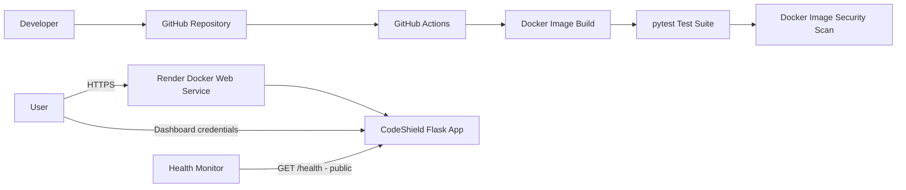
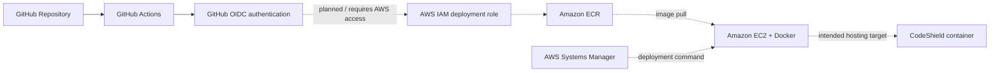

# 🛡️ CodeShield


**CodeShield** is a DevSecOps reference project that demonstrates how a Flask application can be tested, containerized, security-scanned, and deployed through an automated CI/CD workflow.

The current live application is hosted on **Render**. The repository also contains an **AWS deployment pathway and Terraform infrastructure definitions** for a planned ECR → EC2 deployment using GitHub Actions and AWS Systems Manager (SSM). The AWS deployment stages are configured in the workflow but were **not executed in the current run because AWS access/credentials were unavailable**. This distinction is intentional: the project demonstrates the AWS deployment design without claiming that an AWS deployment is live.

**Live application:** https://codeshield-ss6o.onrender.com  
**Health endpoint:** https://codeshield-ss6o.onrender.com/health  
**GitHub repository:** https://github.com/arunava-12/CodeShield

---

## Table of Contents

- [Highlights](#highlights)
- [Current Deployment Status](#current-deployment-status)
- [Architecture](#architecture)
- [CI/CD Pipeline](#cicd-pipeline)
- [Tech Stack](#tech-stack)
- [Project Structure](#project-structure)
- [The Application](#the-application)
- [Getting Started](#getting-started)
- [Infrastructure and AWS Deployment Design](#infrastructure-and-aws-deployment-design)
- [Security Model](#security-model)
- [Configuration](#configuration)
- [Test Results](#test-results)
- [Roadmap](#roadmap)
- [Credits and License](#credits-and-license)

---

## Highlights

- **Automated CI:** GitHub Actions builds the Docker image and runs the application test suite.
- **Container security scanning:** The CI workflow runs a security scan against the built Docker image.
- **Automated tests:** The current local test suite passes **69 tests**.
- **Dashboard authentication:** HTTP Basic Authentication protects the dashboard and protected application routes.
- **Public health check:** `GET /health` remains accessible without dashboard credentials for service health monitoring.
- **Containerized deployment:** The Flask application is packaged and deployed as a Docker service.
- **Live hosting:** The current demonstration deployment is available on Render.
- **AWS deployment design:** The repository includes a workflow pathway for AWS ECR image publishing and EC2 deployment through SSM. These AWS steps are not represented as a completed/live deployment.
- **Infrastructure as Code:** Terraform definitions describe the intended AWS networking, compute, registry, IAM, and storage resources.

---

## Current Deployment Status

| Component | Current status | Notes |
|---|---|---|
| Flask application | Working | Flask 3.1 application |
| Docker image build | Passed | Verified in GitHub Actions |
| Automated tests | Passed | 69/69 tests passed locally; CI test job passed |
| Docker security scan | Passed | Security scan job completed successfully in the latest shown run |
| Dashboard Basic Authentication | Implemented | Requires configured dashboard username and password |
| Public health endpoint | Working | `/health` does not require dashboard login |
| Render deployment | Live | Current demonstration host |
| GitHub Actions CI | Passed | Latest shown run: workflow run #26 |
| AWS ECR publishing | Not executed | AWS access/credentials unavailable for the current run |
| AWS EC2 deployment via SSM | Not executed | AWS deployment steps were skipped |

**Important:** A successful CI/security run confirms the stages that actually ran. It does not mean that the skipped AWS publishing and EC2 deployment stages completed.

---

## Architecture

### Current, verified application path



### AWS deployment pathway (designed, not currently executed)



The AWS diagram represents the intended deployment architecture described by the repository's workflow and Terraform configuration. It is not the currently running hosting path. The live demonstration uses Render.

---

## CI/CD Pipeline

The main workflow is located at:

`.github/workflows/cloudsentinel-ci.yml`

The workflow is named **CodeShield CI**.

### Verified stages in the latest shown GitHub Actions run (#26)

| Stage | Result | Description |
|---|---|---|
| Security Scan job | Passed | Security scanning job completed successfully |
| Checkout code | Passed | Retrieves the repository source |
| Build Docker image | Passed | Builds the CodeShield container image |
| Run tests | Passed | Runs the automated application tests |
| Scan Docker image | Passed | Scans the built image |
| Configure AWS credentials | Skipped | AWS access/credentials were unavailable |
| Verify AWS identity | Skipped | Depends on AWS authentication |
| Login to Amazon ECR | Skipped | Depends on AWS authentication |
| Tag Docker image for ECR | Skipped | Part of the AWS publishing path |
| Push Docker image to ECR | Skipped | Not executed |
| Deploy to EC2 via SSM | Skipped | Not executed |

The workflow also contains a Terraform validation workflow at:

`.github/workflows/terraform.yml`

It is intended to run Terraform formatting, initialization, and validation checks.

### CI behavior

- Pull requests are intended to run the validation, test, and image-security stages without publishing or deploying.
- AWS publishing and deployment are separate stages and require working AWS credentials and permissions.
- The latest shown run completed successfully for the stages that executed. AWS stages were skipped.

---

## Tech Stack

| Layer | Tools |
|---|---|
| Application | Python, Flask |
| Testing | pytest |
| Containerization | Docker |
| Application server | Gunicorn |
| CI/CD | GitHub Actions |
| Security | Gitleaks and Trivy workflow tooling |
| Current hosting | Render |
| AWS deployment design | Amazon ECR, EC2, IAM, Systems Manager, OIDC |
| Infrastructure as Code | Terraform |
| Version control | Git and GitHub |

---

## Project Structure

The main repository structure includes:

```text
CodeShield/
├── app/
│   ├── app.py
│   ├── requirements.txt
│   ├── requirements-dev.txt
│   └── templates/
│       └── index.html
├── tests/
│   └── test_app.py
├── .github/
│   └── workflows/
│       ├── cloudsentinel-ci.yml
│       └── terraform.yml
├── Dockerfile
├── .dockerignore
├── providers.tf
├── variables.tf
├── vpc.tf
├── ec2.tf
├── ecr.tf
├── iam.tf
├── github-oidc.tf
├── s3.tf
├── outputs.tf
└── LICENSE
```

---

## The Application

CodeShield is a lightweight Flask application with a web dashboard and JSON endpoints.

| Endpoint | Description | Authentication |
|---|---|---|
| `GET /` | Dashboard showing application and pipeline information | HTTP Basic Authentication |
| `GET /health` | Health check returning status, version, and environment | Public |
| `GET /api/info` | Application metadata, status, uptime, and timestamp | HTTP Basic Authentication |

Example health response:

```json
{
  "status": "healthy",
  "version": "1.0.0",
  "environment": "development"
}
```

The live health endpoint is:

https://codeshield-ss6o.onrender.com/health

The environment value shown by the live endpoint reflects the current Render configuration; it can be changed through the `ENVIRONMENT` setting.

### Dashboard authentication

The dashboard and protected application routes use HTTP Basic Authentication.

Required environment variables:

- `DASHBOARD_USERNAME`
- `DASHBOARD_PASSWORD`

If either value is missing, protected routes return a service-configuration error rather than silently allowing access. Invalid or missing credentials receive an authentication challenge. The `/health` endpoint is intentionally excluded so hosting platforms can perform health checks.

Do not commit real dashboard credentials, API tokens, or other secrets to Git.

---

## Getting Started

### Prerequisites

- Python 3.12 or later
- Git
- Docker (for containerized execution)
- PowerShell on Windows, or a compatible terminal

### Clone the repository

```powershell
git clone https://github.com/arunava-12/CodeShield.git
cd CodeShield
```

### Install application dependencies

The requirements files are inside the `app` directory:

```powershell
python -m pip install -r .\app\requirements.txt
python -m pip install -r .\app\requirements-dev.txt
```

### Configure dashboard credentials for local execution

```powershell
$env:DASHBOARD_USERNAME = "admin"
$env:DASHBOARD_PASSWORD = "replace-with-a-strong-local-password"
$env:ENVIRONMENT = "development"
```

Use your own strong password. Do not paste it into source code or commit it.

### Run the application

From the repository root:

```powershell
python .\app\app.py
```

Open:

http://localhost:5000

### Run with Docker

```powershell
docker build -t codeshield .
docker run --rm -p 5000:5000 `
  -e DASHBOARD_USERNAME=admin `
  -e DASHBOARD_PASSWORD="replace-with-a-strong-password" `
  codeshield
```

For real deployments, configure secrets through the hosting platform's environment-variable settings rather than putting them in shell history or source files.

### Run the tests

From the repository root:

```powershell
python -m pytest -q
```

The test suite is located at `tests/test_app.py`.

---

## Infrastructure and AWS Deployment Design

The repository includes Terraform definitions and a GitHub Actions pathway for a future AWS-hosted deployment.

### Intended AWS resources

| Resource | Intended purpose |
|---|---|
| VPC and public subnet | Network for the EC2 host |
| Internet gateway and route table | Public network connectivity |
| EC2 instance | Intended host for the CodeShield container |
| Security group | Controls inbound HTTP and restricted administrative access |
| Amazon ECR | Intended private Docker image registry |
| EC2 IAM role and instance profile | Allows the instance to pull images and receive SSM commands |
| GitHub OIDC provider and IAM role | Intended short-lived authentication for GitHub Actions |
| AWS Systems Manager | Intended remote deployment orchestration |
| S3 bucket | Versioned and encrypted storage defined by the Terraform configuration |

### Intended deployment sequence

1. GitHub Actions builds and tests the Docker image.
2. The image is scanned for vulnerabilities.
3. GitHub Actions authenticates to AWS using OIDC.
4. The image is tagged and pushed to Amazon ECR.
5. AWS Systems Manager sends a deployment command to EC2.
6. EC2 pulls the image and restarts the application container.
7. The deployment process checks the application's health endpoint.

**Implementation status:** The AWS pathway and Terraform definitions are part of the project design, but the AWS authentication, ECR publishing, and EC2/SSM deployment stages were skipped in the latest shown workflow run because AWS access was unavailable. The currently deployed application runs on Render.

### Terraform commands

When AWS access and credentials are available, review the Terraform variables and configuration before provisioning:

```powershell
terraform init
terraform fmt -check
terraform validate
terraform plan
terraform apply
```

Review `allowed_ssh_cidr` carefully before provisioning. Restrict administrative access to trusted IP ranges; do not leave SSH open to the entire internet.

To remove resources created in an AWS account:

```powershell
terraform destroy
```

Only run infrastructure provisioning or destruction when you understand the resources and potential charges.

---

## Security Model

| Control | Implementation / status |
|---|---|
| Dashboard access control | HTTP Basic Authentication using environment variables |
| Public health monitoring | `/health` is intentionally public |
| Automated testing | pytest suite; 69 tests passed locally |
| Container scanning | Docker image scan runs in GitHub Actions |
| Secret scanning | Gitleaks is part of the repository's security workflow design |
| Container hardening | Dockerfile-based container build |
| Cloud authentication | AWS OIDC pathway is configured in the intended workflow; AWS execution was skipped in the latest run |
| Deployment access | SSM-based EC2 deployment is the intended AWS approach; not currently executed |
| Secret management | Runtime credentials belong in hosting-platform environment settings or GitHub/AWS secret configuration, never in committed source |

A successful security scan means the configured scan job completed; it should not be interpreted as a guarantee that the application has no vulnerabilities.

---

## Configuration

### Application environment variables

| Variable | Purpose |
|---|---|
| `APP_VERSION` | Version string returned by the application |
| `ENVIRONMENT` | Environment label returned by the application |
| `DASHBOARD_USERNAME` | Username required for dashboard authentication |
| `DASHBOARD_PASSWORD` | Password required for dashboard authentication |
| `GITHUB_API_TOKEN` | Optional/configured GitHub API credential, if required by the scanning integration |

Set these values in Render's Environment settings for the hosted service. Never include actual secret values in this README.

### AWS/Terraform configuration

See `variables.tf` for the Terraform input variables, including region, project name, network CIDRs, instance type, and SSH access CIDR. AWS resources are not currently running as part of the live Render deployment.

---

## Test Results

Latest local test execution:

```text
69 passed in 0.39s
```

Latest shown GitHub Actions run:

- Workflow: CodeShield CI
- Run: #26
- Security Scan: passed
- Test Application: passed
- Docker image build: passed
- Automated tests: passed
- Docker image scan: passed
- AWS authentication, ECR publishing, and EC2 deployment: skipped

The local test result and GitHub Actions result are separate checks; both passed for the stages described above.

---

## Roadmap

- Enable and verify AWS OIDC authentication with an authorized AWS account.
- Execute and validate the ECR image publishing stage.
- Execute and validate EC2 deployment through Systems Manager.
- Add a post-deployment health verification step for the AWS target.
- Make vulnerability thresholds a blocking CI gate where appropriate.
- Add SAST and dependency scanning.
- Add HTTPS and production-grade ingress for an AWS-hosted deployment.
- Add CloudWatch logs, metrics, and alarms for AWS hosting.
- Generate SBOMs and consider image signing.
- Add a manual approval step before production deployment.

---

## Credits and License

The Terraform foundation for networking and AWS infrastructure is adapted from [`aws-terraform-starter`](https://github.com/egezamb/aws-terraform-starter) by Ege Zambelli. CodeShield builds on that foundation with its Flask application, container workflow, security checks, and intended AWS deployment pathway.

Released under the [MIT License](./LICENSE).
